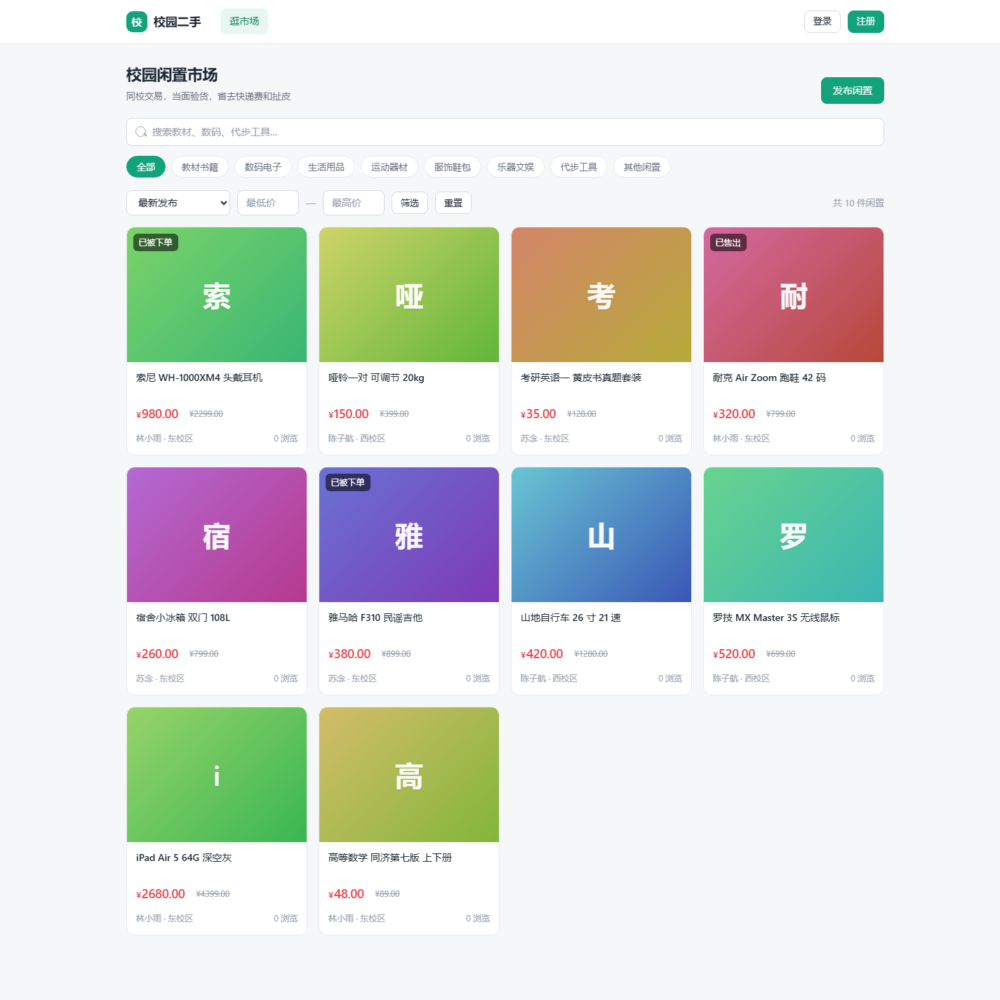
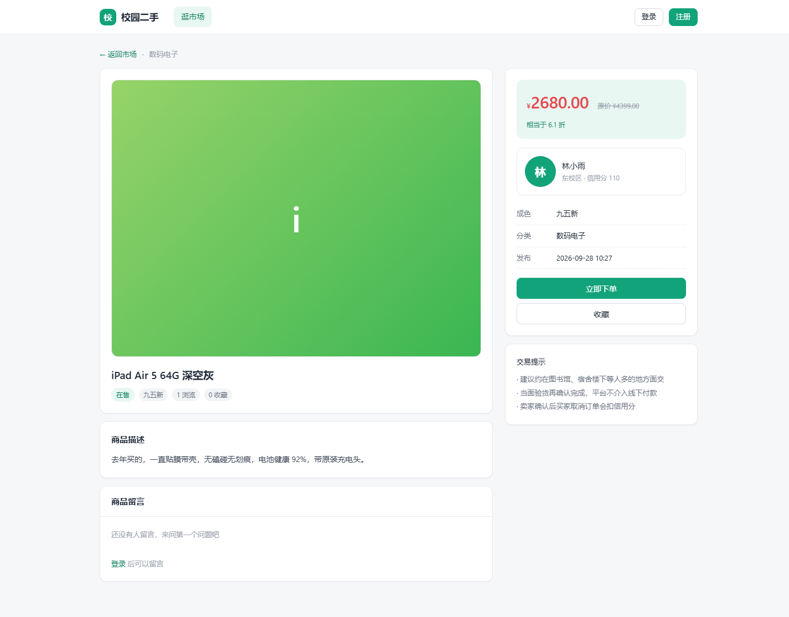
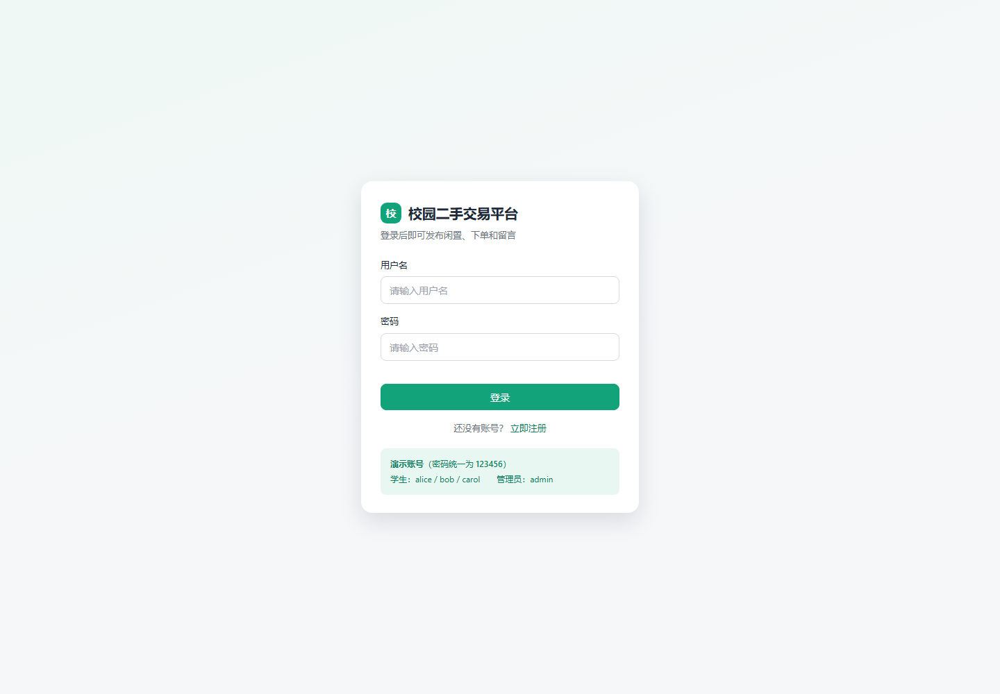
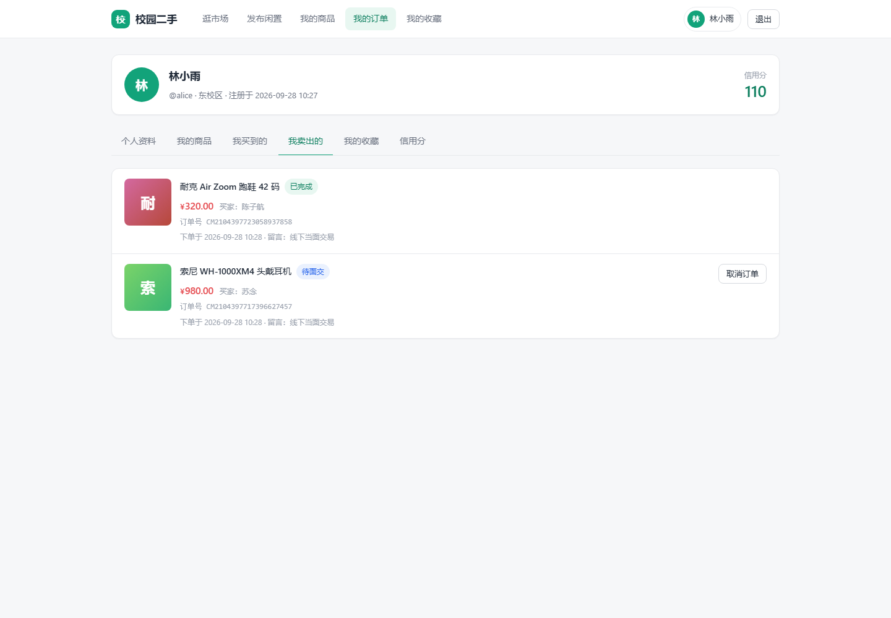
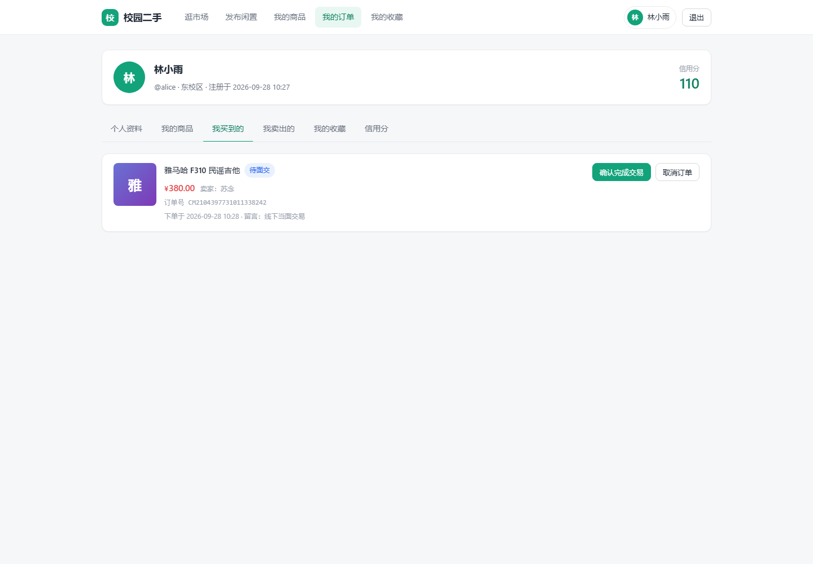
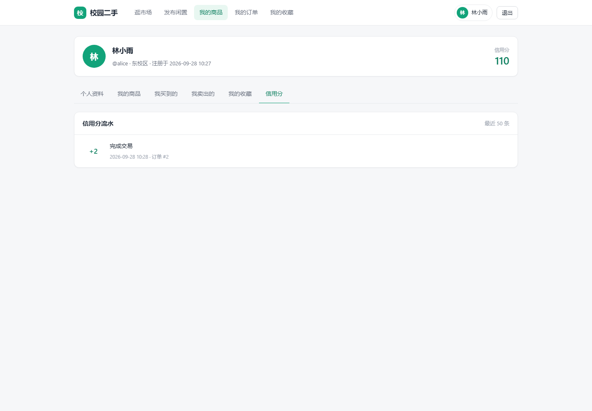
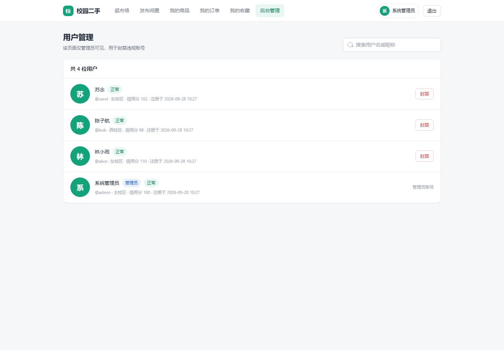
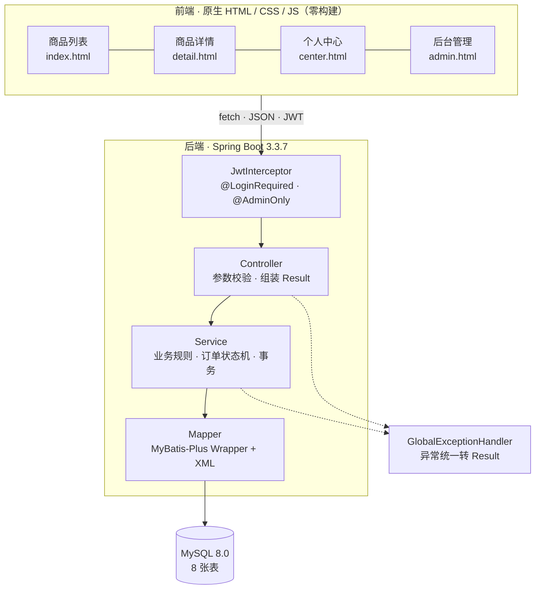
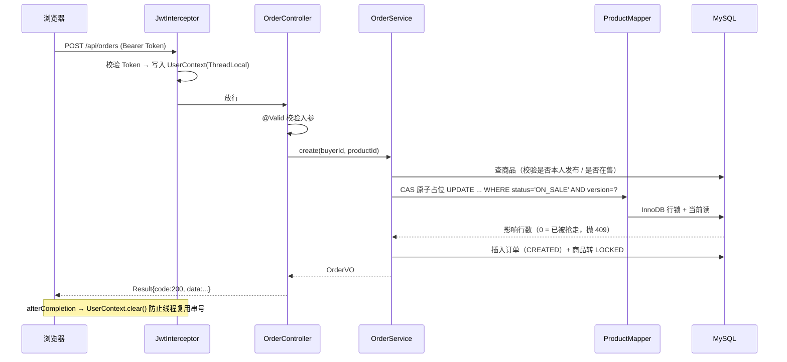
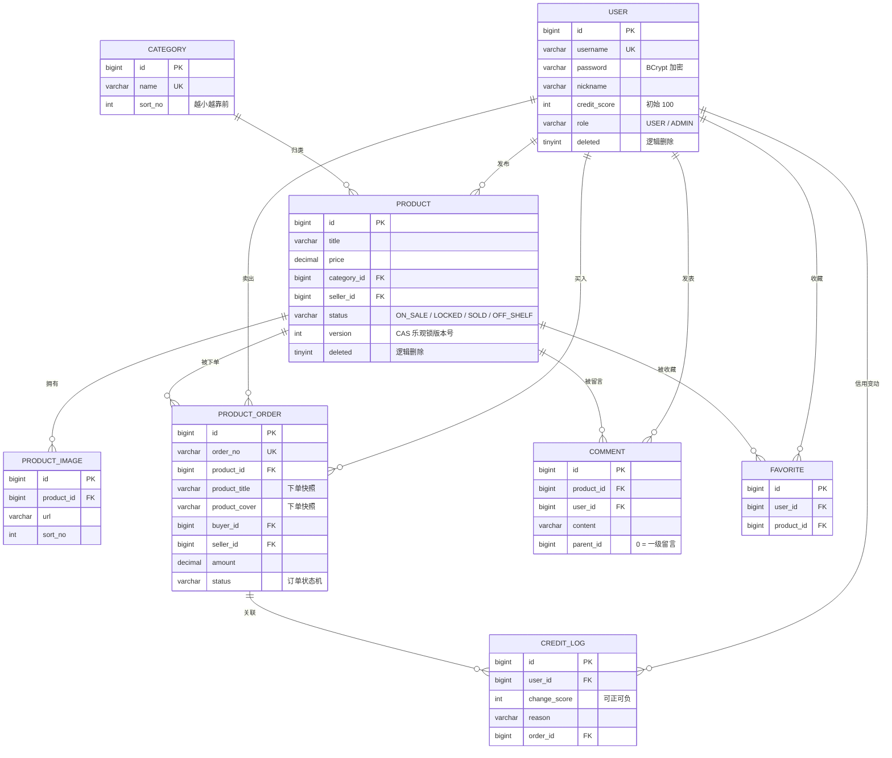

# 校园二手交易平台


一个面向高校学生的二手闲置交易平台。**Spring Boot 3 后端 + 原生 HTML/CSS/JS 前端**，前后端由同一个应用提供，clone 下来建好库就能跑。

---

## 界面预览

| 商品列表 | 商品详情 | 登录注册 |
|---|---|---|
|  |  |  |

| 我卖出的订单 | 我买到的订单 | 信用分流水 |
|---|---|---|
|  |  |  |

| 后台管理 | | |
|---|---|---|
|  | | |

---

## 系统架构



一次下单请求的完整链路，正好串起项目的主要技术点：



---

## 一、技术栈

| 层次 | 选型 | 说明 |
|---|---|---|
| 语言 / 运行时 | Java 21 | 用到了 record、switch 表达式、`Stream.toList()` 等新特性 |
| 框架 | Spring Boot 3.3.7 | Web + Validation |
| 持久层 | MyBatis-Plus 3.5.7 | 单表 CRUD 用 Wrapper，多表关联走 XML |
| 数据库 | MySQL 8.0 | InnoDB，靠行锁 + 唯一索引保证并发正确性 |
| 鉴权 | JJWT 0.12.6 + 自定义拦截器 | 无状态 JWT，不引入 Spring Security 全家桶 |
| 密码加密 | spring-security-crypto | 只取 BCrypt，不带过滤器链 |
| 连接池 | HikariCP | Spring Boot 默认 |
| 前端 | 原生 HTML + CSS + JavaScript | 无框架、无构建步骤，6 个页面 |

**为什么前端不用 Vue/React？** 这个项目的重点是把后端讲透。原生前端零构建、零依赖，面试官打开浏览器就能看到完整效果；同时 CSS 里用了自定义属性（CSS 变量）做设计令牌，也不是"随便写写"的水平。

---

## 二、功能清单

**用户端**
- 注册 / 登录（JWT，Token 存 localStorage）
- 商品浏览：关键词搜索、分类筛选、价格区间、四种排序、分页
- 商品详情：多图切换、浏览量统计、卖家信息与信用分
- 发布 / 编辑 / 下架 / 上架 / 删除商品，支持多图上传
- 收藏 / 取消收藏，我的收藏列表
- 下单 → 卖家确认 → 买家确认完成 / 取消，订单列表区分"我买到的"和"我卖出的"
- **订单超时自动取消**：长时间停留在「待卖家确认 / 待面交」的订单由定时任务自动取消，
  商品释放回在售，不会出现「僵尸订单把商品占死」
- 商品留言
- 个人中心：资料修改、信用分流水

**管理端**
- 用户列表（搜索 + 分页）
- 封禁 / 解封账号

---

## 三、目录结构

```
campus-market/
├── mvnw / mvnw.cmd              # 项目自带 Maven 启动器（见「常见问题」）
├── .mvn/settings.xml            # 阿里云镜像，加速依赖下载
├── pom.xml
├── sql/init.sql                 # 建库 + 建表 + 分类初始数据（MySQL）
├── scripts/smoke-test.sh        # 接口冒烟测试，108 项断言
├── scripts/timeout-demo.sh      # 订单超时自动取消的演示与验证
├── docs/面试讲点.md              # 面试问答准备（12 个技术深挖点）
├── docs/简历话术.md              # 简历怎么写这个项目
├── docs/screenshots/            # 界面截图
└── src/
    ├── main/
    │   ├── java/com/campus/market/
    │   │   ├── CampusMarketApplication.java
    │   │   ├── auth/                # JWT 工具、拦截器、注解、ThreadLocal 上下文
    │   │   ├── common/              # 统一响应体、业务异常、全局异常处理、分页包装
    │   │   ├── config/              # MyBatis-Plus、WebMvc、Jackson、密码编码器、配置属性
    │   │   ├── controller/          # 9 个 REST 控制器
    │   │   ├── dto/                 # 请求参数（record + Bean Validation）
    │   │   ├── entity/              # 8 个实体，对应 8 张表
    │   │   ├── enums/               # 商品状态、订单状态机
    │   │   ├── init/                # 演示数据初始化
    │   │   ├── mapper/              # MyBatis-Plus Mapper（含两处 CAS 更新）
    │   │   ├── service/ + impl/     # 业务层
    │   │   ├── task/                # 订单超时自动取消的定时任务
    │   │   └── vo/                  # 响应视图对象
    │   └── resources/
    │       ├── application.yml          # 正式配置（MySQL）
    │       ├── application-h2.yml       # H2 profile，免装 MySQL
    │       ├── db/schema-h2.sql         # H2 兼容建表脚本
    │       ├── mapper/ProductMapper.xml # 多表关联 + 动态 SQL
    │       └── static/                  # 前端（HTML/CSS/JS，6 个页面）
    └── test/java/com/campus/market/
        ├── enums/                   # 状态机流转矩阵单元测试（17 项）
        ├── service/impl/            # 超时取消的竞争分支单元测试（8 项）
        └── web/                     # MockMvc 接口层集成测试（28 项，跑在 H2 上）
```

> `./mvnw test` 会在 JVM 内跑完全部 **53 项**自动化测试，**不需要本机装 MySQL**——
> 测试跑在 H2 兼容模式上，CI 里也能直接跑。

---

## 四、快速开始

### 1. 前置条件

- JDK 17+（推荐 21）
- 不需要单独安装 Maven，用项目自带的 `mvnw` 即可
- **走方式一（正式）**：MySQL 8.0，且服务已启动
- **走方式二（快速体验）**：什么都不用装，用内置的 H2 内存库

> 两种方式选一个。方式一是本项目的正式运行环境；方式二只是为了让别人拿到代码能立刻看到效果，**业务代码一行都不用改**。

### 2. 建库

```bash
mysql -u root -p < sql/init.sql
```

脚本会自动 `CREATE DATABASE campus_market`，建好 8 张表并写入 8 个商品分类。

### 3. 配置数据库密码

代码默认读 `root / 123456`。密码不是这个的话，**有三种做法，任选其一**。

**做法 A（推荐）：用本地配置文件，凭据不进版本控制**

在项目根目录建 `application-local.yml`（该文件已在 `.gitignore` 中，不会被提交）：

```yaml
spring:
  datasource:
    username: root
    password: 你的密码
```

然后用 `local` profile 启动（见下一节）。Spring Boot 会自动加载项目根目录下的 `application-local.yml`。

**做法 B：用环境变量**

```bash
# Git Bash / Linux / macOS
export DB_USERNAME=root
export DB_PASSWORD=你的密码

# Windows CMD
set DB_USERNAME=root
set DB_PASSWORD=你的密码
```

**做法 C：直接改 `src/main/resources/application.yml`**

最省事，但**密码会进 git 历史**，个人项目无所谓，多人协作时别这么干。

### 4. 启动

```bash
# 方式一：MySQL + 本地配置文件（推荐）
./mvnw spring-boot:run -Dspring-boot.run.profiles=local

# 方式一（变体）：MySQL + 环境变量
./mvnw spring-boot:run

# Windows CMD / PowerShell 把 ./mvnw 换成 mvnw.cmd
```

首次启动会自动创建演示账号和 10 件演示商品（只在 user 表为空时执行）。

> 启动日志里出现 `Added connection com.mysql.cj.jdbc.ConnectionImpl` 就说明连的是 MySQL；
> 若看到 `org.h2.jdbc.JdbcConnection` 则是走了 H2 profile。

### 5. 访问

打开 <http://localhost:8080>

| 角色 | 账号 | 密码 |
|---|---|---|
| 学生 | `alice` / `bob` / `carol` | `123456` |
| 管理员 | `admin` | `123456` |

**建议的体验路径**：用 `alice` 登录 → 逛逛市场 → 用 `bob` 登录下单 alice 的商品 → 切回 `alice` 确认订单 → 切回 `bob` 确认完成 → 看双方信用分各 +2。

### 6. 打包部署

```bash
./mvnw clean package -DskipTests
java -jar target/campus-market-1.0.0.jar
```

### 7. 方式二：不装 MySQL 也能跑（H2 内存库）

项目内置了一个 `h2` profile，用 H2 的 MySQL 兼容模式启动，业务代码一行都不用改：

```bash
./mvnw spring-boot:run -Dspring-boot.run.profiles=h2
# 或者
java -jar target/campus-market-1.0.0.jar --spring.profiles.active=h2
```

数据全在内存里，进程退出即清空，每次启动都是干净的演示数据。适合快速体验和跑集成测试，不适合正式运行。

### 8. 自动化测试（JVM 内，不需要数据库）

```bash
./mvnw test
```

一条命令跑完 **53 项**测试，**不需要先启动应用，也不需要本机装 MySQL**：

| 层 | 数量 | 覆盖内容 |
|---|---|---|
| 单元测试 | 25 | 订单状态机完整流转矩阵、商品状态、超时取消的竞争分支 |
| 集成测试（MockMvc） | 28 | 鉴权 401/403、参数校验 400、404/409/422、**HTTP 恒 200 契约**、密码不泄露、防账号枚举、超时 SQL 判定逻辑 |

集成测试跑在 `h2` profile 上，用 `MockMvc` 在同一个 JVM 里走完整条 Spring MVC 链路（拦截器、参数绑定、全局异常处理），所以 CI 里也能直接跑。

### 9. 接口冒烟测试

启动应用后，另开一个终端：

```bash
bash scripts/smoke-test.sh
```

脚本会跑 **108 项**断言，覆盖鉴权、权限隔离、参数校验、发布、下单、**并发防超卖（10 个请求同时抢同一件商品，断言恰好只有 1 个成功）**、订单状态机、信用分结算、逻辑删除、收藏留言、搜索排序等。当前全部通过。

> 和上面的 MockMvc 集成测试不重复：MockMvc 用的是内存里的假 Servlet 容器，
> 这个脚本打的是**真的 HTTP 端口 + 真的 MySQL**，专门用来兜住「真实事务与并发」这类
> 只有真实环境才能暴露的问题。

---

## 五、接口清单

统一前缀 `/api`。所有响应体格式为 `{ "code": 200, "message": "操作成功", "data": ... }`，
**HTTP 状态码恒为 200，业务结果由 `code` 表达**，前端只需判断 `code === 200`。
需要登录的接口通过 `Authorization: Bearer <token>` 携带凭证。

业务状态码定义在 `ResultCode`：

| code | 含义 | 典型场景 |
|---|---|---|
| 200 | 成功 | —— |
| 400 | 参数校验失败 | 用户名格式不对、售价为 0、留言为空 |
| 401 | 未登录 / 凭证失效 | 没带 Token、Token 被篡改或过期 |
| 403 | 无权限 | 改别人的商品、普通用户访问管理端、买家去确认订单 |
| 404 | 资源不存在 | 商品已删除、订单不存在 |
| 409 | 状态冲突 | 商品已被抢先下单、重复注册、重复下单 |
| 422 | 业务规则不允许 | 订单状态非法流转、封禁管理员账号 |
| 999 | 系统异常 | 兜底，返回给用户的提示不暴露内部细节 |

> 这里刻意把 **422（业务规则不允许）** 和 **999（服务端出错）** 分开。业务规则拦截不是 bug，混用会让人排查问题时误判严重程度。

### 认证

| 方法 | 路径 | 鉴权 | 说明 |
|---|---|---|---|
| POST | `/api/auth/register` | 公开 | 注册，成功后直接返回 Token |
| POST | `/api/auth/login` | 公开 | 登录 |
| GET | `/api/auth/me` | 登录 | 当前用户信息 |

### 商品

| 方法 | 路径 | 鉴权 | 说明 |
|---|---|---|---|
| GET | `/api/products` | 公开 | 列表，支持 `keyword` `categoryId` `minPrice` `maxPrice` `sort` `page` `size` |
| GET | `/api/products/{id}` | 公开 | 详情（浏览量 +1） |
| GET | `/api/products/mine` | 登录 | 我发布的 |
| POST | `/api/products` | 登录 | 发布 |
| PUT | `/api/products/{id}` | 登录 | 编辑（仅本人或管理员） |
| DELETE | `/api/products/{id}` | 登录 | 删除（逻辑删除） |
| POST | `/api/products/{id}/off-shelf` | 登录 | 下架 |
| POST | `/api/products/{id}/on-shelf` | 登录 | 重新上架 |

### 订单

| 方法 | 路径 | 鉴权 | 说明 |
|---|---|---|---|
| POST | `/api/orders` | 登录 | 下单（CAS 抢占商品） |
| GET | `/api/orders/bought` | 登录 | 我买到的 |
| GET | `/api/orders/sold` | 登录 | 我卖出的 |
| GET | `/api/orders/{id}` | 登录 | 订单详情 |
| POST | `/api/orders/{id}/confirm` | 登录 | 卖家确认 |
| POST | `/api/orders/{id}/finish` | 登录 | 买家确认完成 |
| POST | `/api/orders/{id}/cancel` | 登录 | 取消订单 |

### 其他

| 方法 | 路径 | 鉴权 | 说明 |
|---|---|---|---|
| GET | `/api/categories` | 公开 | 分类列表 |
| GET | `/api/products/{id}/comments` | 公开 | 留言列表 |
| POST | `/api/products/{id}/comments` | 登录 | 发表留言 |
| POST | `/api/favorites/{productId}` | 登录 | 收藏 / 取消收藏（切换） |
| GET | `/api/favorites/mine` | 登录 | 我的收藏 |
| GET | `/api/users/{id}` | 公开 | 他人主页（不含手机号） |
| PUT | `/api/users/me` | 登录 | 修改资料 |
| GET | `/api/users/me/credit-logs` | 登录 | 信用分流水 |
| POST | `/api/files/upload` | 登录 | 图片上传 |
| GET | `/api/admin/users` | 管理员 | 用户列表 |
| PUT | `/api/admin/users/{id}/status` | 管理员 | 封禁 / 解封 |

---

## 六、数据库设计

8 张表，`user` / `category` / `product` / `product_image` / `product_order` / `comment` / `favorite` / `credit_log`。



> 表之间**没有建外键约束**，只建了索引。这是刻意的：外键会在写入时加额外的锁、且不利于日后分库分表；一致性由 Service 层保证。ER 图里的连线表达的是**逻辑关系**，不是数据库约束。

关键设计点：

- **`product.version`**：乐观锁版本号，配合 CAS 更新实现防超卖。
- **`product_order` 冗余 `product_title` / `product_cover`**：下单快照，卖家之后改标题改价不影响历史订单的展示与对账。
- **`favorite` 的 `uk_user_product` 唯一索引**：并发重复收藏的最终防线，不依赖应用层的"先查再插"。
- **`credit_log` 流水表**：信用分不只是一次加减，而是可追溯的流水，方便日后核对与回滚。
- **逻辑删除**：`product` / `user` 用 `deleted` 字段 + MyBatis-Plus `@TableLogic`，删除是 `UPDATE ... SET deleted = 1`。

订单状态机：

```
CREATED（待卖家确认） ──卖家确认──> CONFIRMED（待面交） ──买家完成──> FINISHED（终态）
        │                                   │
        └────────── 买家/卖家取消 ───────────┴──────────> CANCELLED（终态）
```

商品状态机：

```
ON_SALE ──下单锁定──> LOCKED ──交易完成──> SOLD
                          └──订单取消──> ON_SALE
ON_SALE <──上架/下架──> OFF_SHELF
```

---

## 七、常见问题

### Q: 为什么项目里带了 `mvnw`，而不是直接用系统装的 `mvn`？

因为你的机器上（Maven 3.9.14 + Git Bash）官方 `mvn` 脚本有一个路径转换缺陷：

脚本第 88-95 行的 MinGW 分支把 `MAVEN_HOME` 转成了 Unix 形式（`/e/Maven/...`），
但把路径**转回** Windows 形式（`cygpath --path --windows`）的逻辑只写在 `if $cygwin` 分支里，
MinGW 下不会执行。结果传给 `java` 的 `-classpath` 是 Unix 路径，Java 找不到 jar，报：

```
错误: 找不到或无法加载主类 org.codehaus.plexus.classworlds.launcher.Launcher
原因: java.lang.ClassNotFoundException: ...
```

项目自带的 `mvnw` 直接以 Windows 路径调用 Maven 的 java 内核，绕开了这个缺陷。
如果你在 IDEA 里开发，用 IDEA 自带的 Maven 也完全没问题（IDEA 不走这个脚本）。

### Q: 启动报 `Access denied for user 'root'@'localhost'`

数据库密码不对。按上面第 3 步用 `DB_PASSWORD` 环境变量覆盖，或改 `application.yml`。

### Q: 启动报 `Table 'campus_market.user' doesn't exist`

没有执行 `sql/init.sql`。

### Q: 演示数据没有生成

`DemoDataInitializer` 只在 `user` 表为空时执行。想重新生成，执行：

```sql
TRUNCATE TABLE credit_log; TRUNCATE TABLE favorite; TRUNCATE TABLE comment;
TRUNCATE TABLE product_order; TRUNCATE TABLE product_image; TRUNCATE TABLE product;
TRUNCATE TABLE `user`;
```

然后重启应用。

### Q: 上传的图片存在哪？

默认 `./uploads/`（相对于启动目录），按 `yyyyMMdd` 分目录。路径可通过 `app.upload.dir` 配置。

---

## 八、可以继续做的事

如果面试官问"这个项目还有什么可以改进的"，这些是真实存在的方向，不是凑数：

1. **引入 Redis** 做商品详情缓存与浏览量计数，减轻数据库压力
2. **把订单超时未确认自动取消** 做成延时任务（RabbitMQ 死信队列 / Redis ZSet）
3. **接入分布式锁** 替代单库行锁，为分库分表做准备
4. **接口幂等令牌**：下单接口加客户端生成的 `requestId`，防止用户连点两次
5. **Elasticsearch** 替换 `LIKE` 模糊搜索，支持分词与相关性排序
6. **测试用 Testcontainers 起真实 MySQL**。现在的集成测试跑在 H2 的 MySQL 兼容模式上，图的是「不装数据库也能跑、CI 友好」，代价是方言差异（`ON DUPLICATE KEY UPDATE`、部分窗口函数、索引行为都与真 MySQL 不完全一致）。Testcontainers 能消除这个差异，但要求 CI 环境能跑 Docker。
7. **统一接口参数风格**。管理端「封禁用户」的 `status` 走的是 query 参数，其余写接口都是 JSON body，属于历史遗留的不一致。
8. **前端组件化**：页面变多后可以迁到 Vue 3 + Vite
